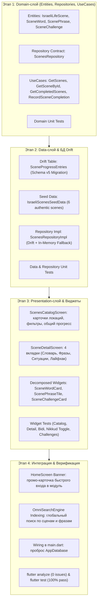

# Архитектурный план: Реальный Израиль (Israeli Life Scene Explorer & Simulator)

Документ описывает согласованный архитектурный план и реализацию модуля интерактивных бытовых сцен (**«Реальный Израиль: Бытовые интерактивные сцены»**) в приложении **Nexus Hebrew App** в строгом соответствии с `GEMINI.md` и плейбуком `/flutter-clean-arch-playbook`.

---

## 1. Архитектурные решения (Design Consensus)

### 1.1. Модель данных и сценарии выживания (Survival Scenarios)
- **6 ключевых локаций репатрианта и туриста:**
  1. `scene_supermarket` — 🛒 Супермаркет и покупки (касса, пакеты, взвешивание, скидочные карты).
  2. `scene_transport` — 🚌 Автобус, поезд и Рав-Кав (валидаторы, пересадки, пополнение, остановки).
  3. `scene_clinic` — 🏥 Поликлиника и аптека (больничные кассы, запись, рецепты, симптомы).
  4. `scene_cafe` — ☕ Кафе и заказ (халав шквадим/соя, степень прожарки, оплата счета, чаевые).
  5. `scene_rental` — 🔑 Аренда жилья и коммуналка (договор, бааль байт, ваад байт, арнона, поломки).
  6. `scene_bureaucracy` — 📮 МВД (Мисрад а-Пним) и Почта (электронная очередь MyVisit, бланки, посылки).
- **Разделение ролей в диалогах:**
  - `PhraseRole.theySay` (`Вам скажут 👂`, `isIncoming = true`) — фразы кассиров, контролеров, врачей, чиновников, которые критично понимать на слух.
  - `PhraseRole.youSay` (`Вы ответите 🗣️`, `isIncoming = false`) — готовые шаблоны уверенных и вежливых ответов.
- **Интерактивный тренажёр-квест (Situational Challenges):**
  - Мини-ситуация с выбором правильной реакции из 3–4 вариантов, немедленным фидбеком и культурологическим разбором (почему именно так принято отвечать в Израиле).

### 1.2. Персистентность и SQLite (Drift v5)
- Локальная таблица `SceneProgressEntries`:
  - `scene_id` (TEXT, Primary Key),
  - `is_completed` (BOOL),
  - `words_mastered_count` (INT),
  - `challenge_score` (INT),
  - `last_visited_at` (DATETIME).
- Миграция БД Drift с версии 4 на 5 через `m.createTable(sceneProgressEntries)`.

### 1.3. Bidi, RTL и огласовки (Hebrew Typography & Nikkud)
- Полная изоляция текстовых направлений: контент на иврите строго `TextDirection.rtl`, интерфейс на русском/английском — `LTR`.
- Поддержка переключателя никкуда (полный текст с огласовками `hebrewVocalized` $\leftrightarrow$ `hebrewNormalized` ктив мале).
- Шрифт `Heebo` с увеличенным `height: 1.45`, предотвращающим обрезание диакритических знаков снизу и сверху.

### 1.4. Интеграция с FSRS и аудиосистемой
- Каждое слово и фраза сцены снабжены кнопкой мгновенного добавления в FSRS-колоду повторений (`+FSRS`).
- Озвучка фраз через `AudioPlaybackService` с гибридным фолбэком на локальный TTS и санитизацией текста (`TtsTextSanitizer`).

### 1.5. Глобальный поиск (Omni-Search Spotlight)
- Индексация названий, слов и фраз всех сцен в `OmniSearchEngine` с моментальным переходом в сцену прямо из поисковой строки.

---

## 2. Поэтапный план реализации

---

## 3. Детальный состав этапов

### Этап 1: Доменный слой (Domain Layer)
- [x] Сущности `IsraeliLifeScene`, `SceneType`, `SceneWord`, `ScenePhrase`, `PhraseRole`, `SceneChallenge` (`Equatable`, `const`).
- [x] Интерфейс `ScenesRepository` (`Result<T, Failure>`).
- [x] Сценарии использования (UseCases):
  - `GetScenesUseCase` — получение списка доступных бытовых сцен;
  - `GetSceneByIdUseCase` — получение сцены по идентификатору;
  - `GetCompletedScenesUseCase` — получение статуса прохождения сцен;
  - `RecordSceneCompletionUseCase` — сохранение прогресса и очков квеста.
- [x] Юнит-тесты доменного слоя (`test/features/scenes/domain/`).

### Этап 2: Слой данных и БД (Data Layer & Drift)
- [x] Датасет сидов `IsraeliScenesSeedData` (словарь, фразы, квесты и лайфхаки для 6 сцен).
- [x] Таблица `SceneProgressEntries` в `AppDatabase`, инкремент версии схемы до 5 и миграция.
- [x] Генерация кода через `build_runner`.
- [x] Реализация `ScenesRepositoryImpl` с кэшированием и БД.
- [x] Тесты репозитория (`test/features/scenes/data/repositories/scenes_repository_impl_test.dart`).

### Этап 3: Слой представления (Presentation Layer)
- [x] `ScenesCatalogScreen` — витрина сцен с прогрессом, уровнями CEFR и бейджами прохождения.
- [x] `SceneDetailScreen` — экран детального изучения с 4 вкладками: «Словарь», «Фразы», «Ситуации», «Лайфхак».
- [x] Виджеты: `SceneWordCard`, `ScenePhraseTile`, `SceneChallengeCard`.
- [x] Переключатель огласовок (никкуд) и озвучка через TTS.
- [x] Виджет-тесты каталога и экрана сцены (`test/features/scenes/presentation/screens/`).

### Этап 4: Интеграция и верификация
- [x] Баннер «Реальный Израиль» на `HomeScreen`.
- [x] Индексация контента сцен в `OmniSearchEngine`.
- [x] Проброс зависимостей в `main.dart`.
- [x] Статический анализ `flutter analyze` — 0 предупреждений.
- [x] Прогон полного тестового набора `flutter test` — 100% тестов пройдено.
