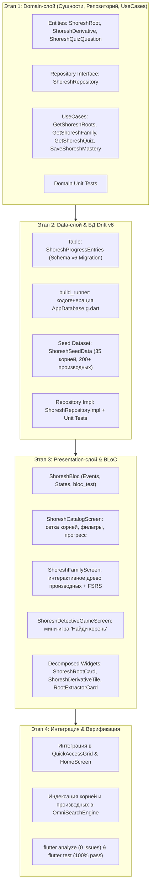

# Архитектурный план: Шореш-Детектив (Shoresh Detective & Word Family Lab)

Документ описывает согласованный архитектурный план и реализацию модуля корней и словообразования иврита (**«Шореш-Детектив: Интерактивная лаборатория корней»**) в проекте **Nexus Hebrew App** в строгом соответствии с `GEMINI.md` и плейбуком `/flutter-clean-arch-playbook`.

---

## 1. Архитектурные решения (Design Consensus)

### 1.1. Концепция и образовательная ценность
- **Корень (שורш) как ключ к ивриту:** 80% лексики иврита строится на 3-буквенных корнях. Освоение 35 базовых корней даёт понимание более чем 250 производных слов.
- **Древо корня (Root Family Tree):**
  - Группировка производных по морфологическим веткам:
    - 🔨 *Глаголы* (по породам: Пааль, Пиэль, Ифъиль, Итпаэль и т.д.);
    - 📦 *Существительные и предметы* (мишкали: מַכְתֵּבָה, מִכְתָּב);
    - 👤 *Профессии и действующие лица* (мишкаль какаль: כַּתָּב, טַבָּח);
    - 🌟 *Прилагательные и свойства*;
    - 📜 *Абстрактные понятия и процессы* (כְּתִיבָה, הִתְכַּתְּבוּת).
- **Игровой тренажёр «Шореш-Детектив» (Root Extractor Game):**
  - Интерактивный квест: дано сложное производное слово (например, `מַדְרִיךְ`, `הִתְנַצְּלוּת`, `מַשְׁקִיעַ`).
  - Ученик должен отсечь служебные буквы (приставки и суффиксы משכנתי / איתן) и найти спрятанный 3-буквенный корень.
  - Мгновенное визуальное объяснение схемы словообразования.

### 1.2. База данных Drift (v6 Migration)
- Таблица `ShoreshProgressEntries`:
  - `root_id` (TEXT, Primary Key);
  - `is_mastered` (BOOL);
  - `quiz_correct_count` (INT);
  - `derivatives_learned` (INT);
  - `last_practiced_at` (DATETIME, nullable).
- Миграция схемы Drift с версии 5 до 6: `m.createTable(shoreshProgressEntries)`.

### 1.3. Bidi, RTL и типографика (Hebrew Typography)
- Контент на иврите: строго `TextDirection.rtl` с Unicode Bidi изоляцией при смешивании языков.
- Полная поддержка огласовок (никкуд) и ктив мале с переключателем в AppBar.
- Шрифт `Heebo` с `height: 1.45+` для защиты знаков никкуда.

### 1.4. Интеграция с FSRS и аудио (TTS)
- 1-tap кнопка «+FSRS» на каждом производном слове древа для добавления в интервальные повторения.
- Озвучка слов и примеров через `AudioPlaybackService` с гибридным fallback на TTS.

---

## 2. Поэтапный план реализации

---

## 3. Чек-лист реализации

### Этап 1: Доменный слой (Domain Layer)
- [x] Сущности `ShoreshRoot`, `ShoreshDerivative`, `ShoreshPartOfSpeech`, `ShoreshQuizQuestion` (`Equatable`, `const`).
- [x] Контракт `ShoreshRepository` (`Future<Result<T, Failure>>`).
- [x] UseCases:
  - `GetShoreshRootsUseCase`
  - `GetShoreshFamilyUseCase`
  - `GetShoreshQuizUseCase`
  - `SaveShoreshMasteryUseCase`
  - `GetMasteredShoreshRootsUseCase`
- [x] Unit-тесты доменного слоя в `test/features/shoresh/domain/`.

### Этап 2: Слой данных и БД (Data Layer & Drift v6)
- [x] Таблица `ShoreshProgressEntries` в `app_database.dart`, инкремент схемы до 6 и миграция.
- [x] Запуск `build_runner`.
- [x] Датасет `ShoreshSeedData` (35 корневых семейств, 140+ слов).
- [x] Реализация `ShoreshRepositoryImpl` (Drift + fallback).
- [x] Тесты репозитория в `test/features/shoresh/data/`.

### Этап 3: Presentation-слой & BLoC
- [x] `ShoreshBloc`, `ShoreshEvent`, `ShoreshState`.
- [x] `bloc_test` + `mocktail` тесты BLoC.
- [x] Экран каталога `ShoreshCatalogScreen`.
- [x] Экран древа корня `ShoreshFamilyScreen`.
- [x] Экран игры «Детектив корней» `ShoreshDetectiveGameScreen`.
- [x] Декомпозированные виджеты (`ShoreshRootCard`, `ShoreshDerivativeTile`, `RootExtractorQuizCard`).
- [x] Виджет-тесты в `test/features/shoresh/presentation/`.

### Этап 4: Интеграция и верификация
- [x] Добавление тайлов «Шореш-Детектив» и «Реальный Израиль» в `QuickAccessGrid` на `HomeScreen`.
- [x] Индексация в `OmniSearchEngine` с категорией `OmniResultCategory.shoresh`.
- [x] `flutter analyze` — 0 предупреждений (No issues found).
- [x] `flutter test` — 100% тестов пройдено (378/378 тестов зелёные).
- [x] Git commit, push и Hot Restart.

---

### Этап 5: Daily Workout 2.0 & Панель Мастерства в Прогрессе
- [x] **Расширение DailyWorkoutPlan:** добавлена поддержка 5 шагов (FSRS -> Грамматика -> Аудирование -> Шореш дня -> Ситуация дня).
- [x] **Генератор тренировки дня:** `GetDailyWorkoutUseCase` подтягивает случайные корни и бытовые ситуации из репозиториев/сидов.
- [x] **Презентационный экран тренировки:** в `DailyWorkoutScreen` добавлены интерактивные шаги `WorkoutStep.shoresh` и `WorkoutStep.scene` с морфологическими карточками, фидбеком и адаптивным переходом.
- [x] **Панель мастерства на экране Прогресса:** в `ProgressScreen` добавлены карточки `_ShoreshMasteryCard` («Лаборатория корней (Шореш)») и `_ScenesProgressCard` («Реальный Израиль: Быт») с прогресс-барами, рангом детектива и быстрой навигацией.
- [x] **Расчет XP и активности:** в `ProgressLocalDataSource` добавлены запросы к `ShoreshProgressEntries` и `SceneProgressEntries`, таймстампы включены в стрик и тепловую карту активности.
- [x] **Верификация:** `flutter analyze` (0 issues), 380/380 тестов пройдено (100% pass), фиксация коммита и Hot Restart в Chrome.

---

### Этап 6: Голосовой тренажёр живых ситуаций и произношения (Voice Roleplay)
- [x] **Микрофон в карточках фраз (`ScenePhraseTile`):** кнопка `Icons.mic_rounded` вызывает `PronunciationPracticeSheet` с эталонной фразой, транслитерацией, live STT и пословной оценкой точности через `PronunciationAccuracyEvaluator`.
- [x] **Голосовой ответ в бытовых ситуациях (`SceneChallengeCard`):** опция «Ответить голосом 🎙️ (+10 XP)», автоматическое определение правильности ответа по речи, золотистый бейдж и начисление бонусного опыта.
- [x] **Голосовой ответ в Тренировке Дня (`DailyWorkoutScreen`):** возможность на шаге «Ситуация дня» произнести фразу вслух и получить мгновенный фидбек произношения с бейджем победы.
- [x] **Сквозной проброс аудио и речи:** в `ScenesCatalogScreen` и `SceneDetailScreen` проброшены `AudioPlaybackService` и `SpeechRecognitionService`.
- [x] **Верификация:** `flutter analyze` (0 issues), 380/380 тестов пройдено (100% pass), коммит и Hot Restart в Chrome.

---

### Этап 7: Адаптивный движок по уровню (CEFR A1 ➔ A2 / B1)
- [x] **Персистентность уровня в AppSettingsStorage:** добавлены методы сохранения и чтения `readAssessedLevel`, `writeAssessedLevel`, `readLastAssessmentDate`, `writeLastAssessmentDate`.
- [x] **Интеграция с LevelAssessmentScreen:** автоматическая запись определенного уровня (A1.1 ... B1.2) и даты прохождения теста в хранилище с коллбеком `onLevelUpdated`.
- [x] **Индикация уровня на Главной (`HomeScreen`):** в шапке дашборда рядом со стриком отображается интерактивный бейдж уровня (`«Уровень: A2.1 🎯»` / `«Тест уровня ➔»`).
- [x] **Индикация на экране Прогресса (`ProgressScreen`):** баннер диагностики адаптируется под текущий результат пользователя и приглашает освежить срез знаний.
- [x] **Адаптация тренировки дня (`GetDailyWorkoutUseCase`):** динамический выбор пород глаголов (для A2+ подключаются Пиэль, Ифъиль, Итпаэль) и бытовых сцен повышенной сложности (МВД, аренда, поликлиника).
- [x] **Верификация:** `flutter analyze` (0 issues), тесты хранилища, экрана уровня, главной и тренировки дня успешно пройдены, изменения зафиксированы в `main`.
